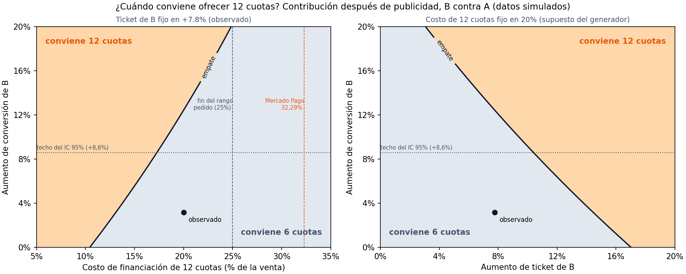

# Supuestos del generador y contraste con fuentes reales

**Los datos siguen siendo simulados** (tienda ficticia, seed 42). Este documento no los convierte en datos reales: lista cada supuesto de `scripts/generate_data.py`, lo compara con una referencia pública cuando la hay y dice dónde no la hay. Ningún supuesto del generador ni resultado del test se cambió para escribirlo.

Fuentes consultadas el 16/11/2026. Solo se cita un valor si la página se abrió y el dato figura en ella. Cuando no se encontró una fuente confiable, el supuesto dice **sin fuente (supuesto propio)**.

**Cómo leer el veredicto:** *dentro del rango* = el valor simulado cae dentro de la referencia o muy cerca; *por encima* / *por debajo* = queda fuera; *sin fuente* = no hay referencia verificada. Varias referencias son de otros mercados (EE.UU., Reino Unido) o de un solo vendedor: se aclara en cada caso, porque eso limita la comparación.

## 1. Fuentes verificadas

| Id | Fuente | Fecha | Dato que se usa (textual o casi textual) |
|---|---|---|---|
| S1 | Mercado Pago, página "Link de pago", tabla "Costos por ofrecer cuotas": <https://www.mercadopago.com.ar/herramientas-para-vender/link-de-pago> | Sin fecha en la página (consultada 16/11/2026) | Costo para el vendedor por ofrecer cuotas: 3 cuotas 10,49%, 6 cuotas 18,69%, 12 cuotas 32,29%; "se sumará al porcentaje que pagás por tus cobros". Costo por cobrar según plazo: al instante 6,29%, 10 días 4,39%, 18 días 3,39%, 35 días 1,49%. No aclara si incluye IVA |
| S2 | Ministerio de Economía, programa Cuota Simple, página "Comerciantes": <https://www.argentina.gob.ar/node/414626> | Sin fecha en la página (consultada 16/11/2026) | Tasas máximas de descuento directo que los bancos pueden cobrarle al comercio: 3 cuotas 5,41%, 6 cuotas 10,31% (cobro a 10 días hábiles). Solo pymes y rubros del programa. No informa 12 cuotas |
| S3 | BCRA, "Tarjeta de débito": <https://www.bcra.gob.ar/tarjeta-de-debito/> | Sin fecha para el dato (consultada 16/11/2026) | Tope de la tasa de intercambio: 0,60% débito y 1,30% crédito. Remite a la Ley 25.065 para los aranceles máximos (el número no está en la página) |
| S4 | Baymard Institute, "Cart Abandonment Rate": <https://baymard.com/lists/cart-abandonment-rate> | Actualizada 28/10/2026 | Abandono promedio de carrito 70,22%: promedio simple de 50 estudios publicados entre 2006 y 2025, rango 55% a 84% |
| S5 | IRP Commerce, "Ecommerce market data" (Reino Unido e Irlanda): <https://www.irpcommerce.com/en/gb/ecommercemarketdata.aspx> | Octubre 2026 (comentario del 16/11/2026) | Conversión por sesión 1,83% (octubre 2025: 1,63%). Moda 1,45%; cocina y hogar 2,05%; deportes 1,83% |
| S6 | LocaliQ (con WordStream), "Search Advertising Benchmarks": <https://localiq.com/blog/search-advertising-benchmarks/> | Actualizada 01/06/2026 | Avisos en buscadores (Google y Microsoft), todas las industrias: CTR 6,64%, CPC USD 5,42. "Shopping, Collectibles & Gifts": CTR 8,28%, CPC USD 4,14. Indumentaria: CTR 6,64%, CPC USD 4,44 |
| S7 | Ámbito (07/11/2025) <https://www.ambito.com/negocios/cybermonday-2025-cerro-una-facturacion-639-mil-millones-y-mas-8-millones-usuarios-n6211434> y Forbes Argentina (07/11/2025) <https://www.forbesargentina.com/negocios/cybermonday-2025-rompio-records-ventas-639-mil-millones-mas-12-millones-productos-vendidos-argentina-n81251> | 07/11/2025 | CyberMonday 2025 (3 al 5 de noviembre), datos atribuidos a la CACE: facturación $639 mil millones, 7 millones de órdenes, ticket promedio $92.000. Descuento promedio 31% (sin atribución explícita a la CACE en la frase). Mercado Libre: "más del 60% de las compras se realizaron con financiación en cuotas" (dato de Mercado Libre, no de toda la CACE) |
| S8 | Digital Commerce 360, "Retailers continue battling fraudulent and abusive returns in 2024": <https://www.digitalcommerce360.com/2025/01/07/online-returns-2024-holiday-season/> | 07/01/2025 | Cita el informe de Appriss Retail y Deloitte: tasa de devolución de ventas online en EE.UU. 2024 24,52%; total 13,21% |
| S9 | FMI, comunicado "New Industry Study Explores Root Causes of Global Out-Of-Stock Dilemma": <https://fmi.org/newsroom/news-archive/view/2002/10/14/new-industry-study-explores-root-causes-of-global-out-of-stock-dilemma> | 14/10/2002 | Estudio de FMI, GMA y CIES (Emory, St. Gallen, Colorado), 71.000 consumidores en 29 países: quiebre de stock promedio mundial 8,3% (comercio físico de consumo masivo) |
| S10 | El Sol (Mendoza), "Crecieron las ventas a través del eCommerce, pero Cuyo quedó en el último lugar": <https://www.elsol.com.ar/mendoza/crecieron-las-ventas-a-traves-del-ecommerce-pero-cuyo-quedo-en-el-ultimo-lugar/> | 23/03/2026 | Cita el último informe de la CACE (datos 2025): "el 37% de los envíos ya se realizó en menos de 24 horas"; 8 de cada 10 usuarios consideran clave poder pagar en cuotas |

**Fuentes que se intentaron y no se pudieron verificar** (no se usa ningún número de ellas): informe MidTerm 2024 de la CACE (la URL devuelve otra página; el informe completo es solo para socios), informe anual 2024 de la CACE (404), WordStream Google Ads y Facebook Ads benchmarks (403), Smart Insights (403), Dynamic Yield (redirige a otro sitio), PDF de Appriss Retail (no se pudo extraer el texto; se usa la cita de S8).

## 2. Inventario de supuestos y contraste

Las líneas son de `scripts/generate_data.py`.

| # | Supuesto | Valor usado | Qué representa | Código | Referencia real | Fuente | Veredicto |
|---|---|---|---|---|---|---|---|
| 1 | Sesiones por canal | Por día: orgánico 2.600, búsqueda paga 1.800, social pago 1.500, email 700, directo 900 | Escala y mezcla de tráfico de la tienda ficticia | L74-80 | No hay referencia: depende del tamaño de cada tienda | | Sin fuente (supuesto propio) |
| 2 | Estacionalidad semanal y crecimiento | Lunes a domingo ×1,00 a ×1,15; +15% en la temporada | Más tráfico el fin de semana y hacia fin de año | L82, L88 | | | Sin fuente (supuesto propio) |
| 3 | Tráfico en eventos | ×2,2 en Cyber Monday, ×2,0 en Black Friday | Pico de visitas en los eventos | L87 | La CACE informa usuarios del sitio del evento, no el aumento frente a días comunes | S7 | Sin fuente |
| 4 | Tasa de agregado al carrito | 8% a 22% según canal; +10% en eventos (resultado: 12,3% de las sesiones) | Sesiones que agregan algo al carrito | L74-80, L99 | Hay benchmarks de proveedores (~6%), pero no se pudo abrir ninguno | | Sin fuente verificada |
| 5 | Checkout y compra (abandono de carrito resultante) | Checkout sobre carrito 38% a 50%; compra sobre checkout 60%, ×1,25 en eventos. Abandono de carrito resultante 72,8% en días comunes y 64,2% en eventos | Embudo carrito → checkout → pedido | L74-81, L100-102 | Abandono promedio 70,22% (rango 55% a 84%) | S4 | Dentro del rango |
| 6 | Rebote | 38% (+5 puntos en social) | Sesiones que no interactúan | L103 | | | Sin fuente (supuesto propio) |
| 7 | Costo por clic | ARS 650 (búsqueda) y 600 (social); +10% en eventos | Costo de la publicidad paga | L76-77, L105 | Solo hay referencias en dólares de EE.UU. (CPC USD 5,42), que no se pueden comparar con pesos de una tienda argentina | S6 | Sin fuente comparable |
| 8 | CTR | Búsqueda 2,0%; social 1,2% | Clics sobre impresiones | L76-77, L106 | Búsqueda: 6,64% en todas las industrias y 8,28% en "Shopping" (EE.UU.). Social: no se pudo verificar | S6 | Búsqueda: por debajo. Social: sin fuente verificada |
| 9 | Descuentos | Días comunes: 12% de los pedidos con 5% a 15%. Eventos: 70% de los pedidos con 10% a 30% (promedio entre los pedidos con promoción: 19,8%) | Profundidad de las promociones | L173-178 | Descuento promedio del CyberMonday 2025: 31% | S7 | Por debajo |
| 10 | Costo de 3 cuotas sin interés | 5% de la venta | Lo que paga el comercio por ofrecer 3 cuotas | L123 | Cuota Simple: 5,41% como máximo. Mercado Pago: 10,49% | S2, S1 | Dentro del rango (en el extremo bajo) |
| 11 | Costo de 6 cuotas sin interés | 10% | Ídem, 6 cuotas | L123 | Cuota Simple: 10,31% como máximo. Mercado Pago: 18,69% | S2, S1 | Dentro del rango (en el extremo bajo) |
| 12 | Costo de 12 cuotas sin interés | 20% | Ídem, 12 cuotas. Es el supuesto que más pesa en la decisión | L123 | Mercado Pago: 32,29%. Cuota Simple no publica 12 cuotas en su página | S1 | Por debajo de la única referencia verificada |
| 13 | Mix de cuotas | Días comunes: 1/3/6 cuotas = 60/20/20%. Eventos A: 40/22/38%. Eventos B: 1/3/6/12 = 35/20/30/15%. Pedidos en cuotas en eventos: 61% (A) y 65% (B) | Cómo eligen pagar los clientes | L181-186 | Mercado Libre, CyberMonday 2025: más del 60% de las compras con financiación en cuotas. La distribución por plazo (CACE MidTerm) no se pudo verificar | S7 | Share en cuotas: dentro del rango (referencia de un solo vendedor). Distribución por plazo: sin fuente verificada |
| 14 | Efecto de las 12 cuotas en la conversión | Compra sobre checkout ×1,08 en B (resultado observado: +3,2% en conversión por sesión) | La hipótesis que el test pone a prueba | L101 | No se encontró un estudio causal. Los datos públicos sobre cuotas son descriptivos | | Sin fuente (supuesto propio) |
| 15 | Efecto de las 12 cuotas en el ticket | Ítems por pedido: Poisson 0,75 en B y 0,60 en A (resultado: +7,8% de ticket) | Canasta más grande al ofrecer más cuotas | L167 | Igual que el anterior | | Sin fuente (supuesto propio) |
| 16 | Comisión de pago | 3% de la venta | Lo que cobra el procesador de pagos | L188 | Mercado Pago: de 1,49% (cobro a 35 días) a 6,29% (al instante). Tope de la tasa de intercambio de crédito: 1,30% | S1, S3 | Dentro del rango |
| 17 | Cancelación | 3% en días comunes y 5% en eventos | Pedidos cancelados antes del envío | L195 | | | Sin fuente (supuesto propio) |
| 18 | Devolución | De 3% a 14% según categoría (resultado: 8,3% de los pedidos) | Pedidos devueltos | L48-55, L201 | Devolución online en EE.UU. 2024: 24,52%. No se encontró un dato de Argentina | S8 | Por debajo (mercado distinto) |
| 19 | Tiempo de entrega | 1 + Gamma(2,2; 1,0) días, escala 1,5 en eventos. Promesa de 5 días. Resultado: mediana 3 días, 0% entregado en 24 horas | Logística | L196-200 | CACE 2025: 37% de los envíos en menos de 24 horas | S10 | Por debajo (la tienda simulada es más lenta que el mercado) |
| 20 | Entregas tarde | Resultado del punto 19: 11% en días comunes y ~29% en eventos | Pedidos entregados después de lo prometido | L200 | | | Sin fuente |
| 21 | Quiebre de stock | 3% de los productos por día en días comunes, 8% en eventos | Productos sin stock | L250 | Promedio mundial 8,3% (comercio físico, 2002) | S9 | Días comunes: por debajo. Eventos: dentro del rango |
| 22 | Precios y márgenes por categoría | Precio base de 15.000 a 120.000; margen bruto de 15% a 65% según categoría | Surtido de la tienda | L48-55 | | | Sin fuente (supuesto propio) |
| 23 | Envío | Costo ~ARS 5.000 (×1,2 en eventos); se cobra 4.500, gratis desde 60.000 | Costo logístico y política de envío | L189-190 | | | Sin fuente (supuesto propio) |
| 24 | Clientes que vuelven | Probabilidad de 10% a 25% en la temporada, ponderada por canal | Recompra | L122, L142-151 | | | Sin fuente (supuesto propio) |
| 25 | CSAT y contactos | CSAT peor si llega tarde; contacto en 5% a 80% de los pedidos según lo que pasó | Atención al cliente | L205-208, L221-227 | | | Sin fuente (supuesto propio) |
| 26 | Provincias | Buenos Aires 30%, CABA 22%, Córdoba 12%... | Geografía de los clientes | L120-121 | La CACE informa el ranking de provincias, no la participación de cada una | S7 | Sin fuente |

## 3. Contraste de los resultados simulados

| Métrica del dataset | Valor simulado | Referencia | Fuente | Veredicto | Por qué |
|---|---|---|---|---|---|
| Conversión global (pedidos / sesiones) | 3,46% | 1,83% (moda 1,45%) | S5 | Por encima | Las tasas del embudo (supuestos 4 y 5) son generosas. Además, la referencia es del Reino Unido y no se encontró una de Argentina o América Latina |
| Abandono de carrito | 71,9% | 70,22% (55% a 84%) | S4 | Dentro del rango | |
| Ticket promedio en eventos | ARS 70.393 (temporada: 76.846) | CyberMonday 2025: ARS 92.000 | S7 | Por debajo (−23%) | La referencia es el promedio de todo el mercado, con electrodomésticos y turismo entre lo más vendido. La tienda simulada tiene precios base fijos para la temporada |
| Descuento en eventos | 19,8% entre los pedidos con promoción; 13,9% sobre toda la venta bruta | 31% promedio | S7 | Por debajo | El generador usa descuentos de 10% a 30% |
| Pedidos en cuotas en eventos | 61% (A) y 65% (B) | Mercado Libre: más del 60% | S7 | Dentro del rango | Un solo vendedor, no todo el mercado |
| Comisión de pago | 3,0% | 1,49% a 6,29% | S1 | Dentro del rango | |
| CTR de búsqueda paga | 2,0% | 6,64% (Shopping: 8,28%) | S6 | Por debajo | La referencia es de EE.UU. y de las cuentas de LocaliQ. El CTR no entra en ningún cálculo del test |
| ROAS de búsqueda y social | 3,6× y 2,4× | | | Sin fuente verificada | |
| Cancelación | 3,5% | | | Sin fuente | |
| Devolución | 8,3% | 24,52% online (EE.UU.) | S8 | Por debajo | Otro mercado, con políticas de devolución más amplias |
| Entregas en 24 horas | 0% (mediana 3 días) | 37% | S10 | Por debajo | El generador no tiene entrega en el día |
| Entregas tarde | 13,9% (11% en días comunes, ~29% en eventos) | | | Sin fuente | |
| Quiebre de stock | 3,1% en días comunes; 7,5% en eventos | 8,3% | S9 | Días comunes: por debajo. Eventos: dentro del rango | Referencia de comercio físico de 2002 |
| Margen de contribución | 26% en días comunes, 12% en eventos | | | Sin fuente | |

**Fuera de rango y relevante para la decisión:** el costo de las 12 cuotas (20% contra 32,29% en Mercado Pago) y la profundidad de los descuentos (20% contra 31%). La conversión global (por encima) y el ticket (por debajo) cambian la escala de los números, pero no la comparación A contra B: las dos variantes comparten el mismo embudo y los mismos precios.

## 4. Análisis de sensibilidad

Script: `scripts/sensitivity.py`. Salidas: `outputs/sensitivity_grid.csv` (grilla completa), `outputs/sensitivity_breakeven.csv` y `docs/report/sensitivity.png`.

El modelo recalcula la contribución después de publicidad de B variando tres supuestos y deja el resto como en el test. Usa la misma definición de contribución que `ab_test.py`, y antes de producir resultados verifica que con los valores observados reproduce el test: B − A = −33.309 por 1.000 sesiones y punto de equilibrio +12,4%. Simplificaciones: el mix de cuotas, el costo de mercadería en % de la venta y el envío neto por pedido no cambian con el ticket.

**Aumento de conversión que necesita B para empatar con A** (positivo = B necesita vender más; negativo = B gana aunque convierta menos):

| Costo de 12 cuotas | Ticket +0% | Ticket +4% | Ticket +7,8% (observado) | Ticket +12% | Ticket +16% | Ticket +20% |
|---|---|---|---|---|---|---|
| 5% | +4,4% | −1,2% | −5,9% | −10,7% | −14,8% | −18,6% |
| 10% | +10,6% | +4,6% | −0,5% | −5,7% | −10,1% | −14,1% |
| 13,1% | +14,8% | +8,5% | +3,1% | −2,2% | −6,8% | −11,0% |
| 15% | +17,6% | +11,1% | +5,5% | +0,0% | −4,7% | −9,1% |
| **20% (generador)** | +25,5% | +18,4% | **+12,4%** | +6,4% | +1,3% | −3,4% |
| 25% | +34,6% | +26,8% | +20,2% | +13,7% | +8,1% | +3,0% |
| 32,29% (Mercado Pago) | +50,4% | +41,4% | +33,7% | +26,2% | +19,8% | +14,0% |

Cómo leerla: con el ticket y el costo observados, B necesita +12,4% de conversión y logró +3,2% (el techo del intervalo de confianza es +8,6%). Conviene 12 cuotas cuando la conversión que se espera supera el valor de la celda.

**Zonas** (en el gráfico, naranja = conviene 12 cuotas, gris = conviene 6):
- **Costo de 12 cuotas:** con la conversión (+3,2%) y el ticket (+7,8%) observados, B empata si el costo baja a 13,1% de la venta. Hasta 25% y en el 32,29% de Mercado Pago, sigue ganando A.
- **Conversión:** con el costo y el ticket observados, B necesita al menos +12,4%. Con el costo de Mercado Pago necesitaría +33,7%.
- **Ticket:** con la conversión observada y el costo del generador (20%), B empata con un aumento de ticket de +14,4% (observado: +7,8%).

## 5. Qué supuestos cambiarían la recomendación

- **Costo de 12 cuotas:** es el que más pesa. La única referencia verificada (Mercado Pago, 32,29%) es más cara que el supuesto (20%) y refuerza la recomendación. Solo un costo de 13,1% o menos (un acuerdo con un banco o un programa oficial con 12 cuotas) la daría vuelta con la conversión observada.
- **Efecto en la conversión y en el ticket:** no tienen fuente, y por eso el test existe. Para que convenga B hace falta un efecto mucho mayor que el observado: +12,4% de conversión, o +14,4% de ticket, con el costo actual.
- **Descuentos más profundos (31% en lugar de 20%):** no están modelados en la sensibilidad. Bajan el margen de cada pedido en las dos variantes. Cuantificarlo requiere una versión nueva del generador.
- **Devoluciones más altas:** el escenario con reembolso ya está calculado (`docs/README.md` y `outputs/ab_results.json`): B necesita +14,0% de conversión en lugar de +12,4%. Más devoluciones refuerzan la recomendación.
- **Conversión global, ticket, CTR, entregas y stock fuera de rango:** cambian la escala de los resultados, pero afectan igual a A y a B, así que no cambian la comparación.

## 6. Cambios propuestos al generador (pendientes de aprobación)

No se aplicó ninguno. Si se aprueban, irían en una versión nueva (seed 42, archivos nuevos) y se volverían a correr el test y los controles:

1. Costo de 12 cuotas: correr la versión principal con 20% y una alternativa con 32,29% (Mercado Pago), en lugar de un solo valor.
2. Descuentos en eventos: rango de 20% a 40% para acercar el promedio al 31% del CyberMonday 2025.
3. Entregas: agregar entrega en 24 horas para una parte de los pedidos, para acercarse al 37% de la CACE.
4. Embudo: bajar la conversión global hacia 2% a 2,5%, documentando que no hay benchmark argentino.
